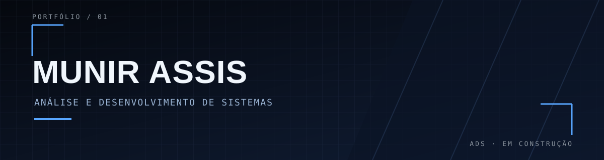

  

  

## Sobre mim

Sou estudante de **Análise e Desenvolvimento de Sistemas**, explorando programação e desenvolvendo projetos para evoluir na prática.

## Tecnologias

  

## Projetos

<table>
  <tr>
    <td align="center" width="33%">
      <h3><a href="https://github.com/MunirAssis/projeto-site">projeto-site</a></h3>
      <a href="https://github.com/MunirAssis/projeto-site">Abrir repositório ↗</a>
    </td>
    <td align="center" width="33%">
      <h3><a href="https://github.com/MunirAssis/SG">SG</a></h3>
      <a href="https://github.com/MunirAssis/SG">Abrir repositório ↗</a>
    </td>
    <td align="center" width="33%">
      <h3><a href="https://github.com/MunirAssis/projeto-cordel">projeto-cordel</a></h3>
      <a href="https://github.com/MunirAssis/projeto-cordel">Abrir repositório ↗</a>
    </td>
  </tr>
</table>

## GitHub

  
  

  

  

  

## Snake de contribuições

O GitHub Actions gera esta animação diariamente. Para iniciar ou executar novamente, abra **Actions** → **Generate contribution snake** → **Run workflow** no repositório.

<picture>
  <source media="(prefers-color-scheme: dark)" srcset="https://raw.githubusercontent.com/MunirAssis/MunirAssis/output/github-contribution-grid-snake-dark.svg">
  <source media="(prefers-color-scheme: light)" srcset="https://raw.githubusercontent.com/MunirAssis/MunirAssis/output/github-contribution-grid-snake.svg">
  
</picture>

## Contato

  
  

  Aprendendo, construindo e evoluindo projeto a projeto.

